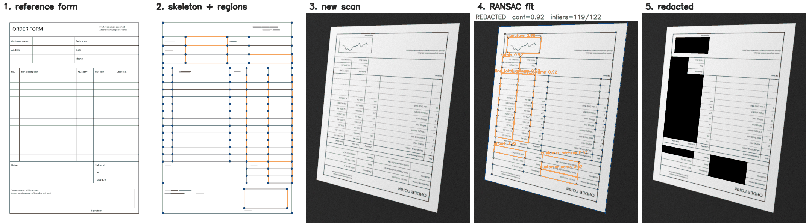
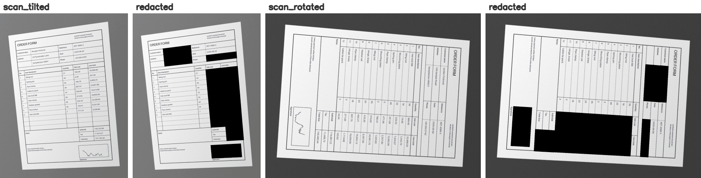

# layout-redact

**Offline document redaction for fixed-layout forms.** Point it at a scan,
photo or PDF of a form you've seen before, and it blacks out the fields you
marked once on a reference copy: names, addresses, phone numbers, prices,
signatures. No OCR, no machine learning, no cloud API. It uses a few hundred lines
of OpenCV geometry: **line-skeleton detection, then RANSAC homography, then
template projection**.



<sub>All images in this repo are synthetic: a made-up order form with fake data, rendered and "scanned" by
`examples/run_demo.py`.</sub>

## Why

Lots of PII redaction work involves the *same form* over and over: delivery
notes, intake sheets, claim forms, application forms, transport papers.
On those, the sensitive data always sits in the same boxes. You don't need a
model to find it. You only need to know where the page is.

- **Private by construction.** Everything runs locally on CPU. Pages never
  leave the machine, and nothing has to be sent to an OCR or LLM service just
  to find out where the PII is.
- **Content-independent.** Matching uses the printed ruling of the form (its
  "skeleton"), not the text. Handwriting, unusual scripts, poor print quality
  and unexpected values don't matter.
- **Robust to real scans.** It handles rotation (including pages fed in
  rotated by 90° or upside down), scale, skew and the perspective of a phone photo.
- **Auditable.** Every page gets a confidence score and a status
  (`REDACTED` / `FLAGGED` / `FAILED`), a JSON report with the fitted
  homography and region polygons, and an optional debug overlay.
- **Fail-closed by default.** If a page can't be matched confidently, no
  output is written for it. It is not silently passed through.

## How it works

```
 reference form (once)                     every incoming page
 ─────────────────────                     ───────────────────
 clean image of the form                   scan / photo / PDF page
        │                                          │
        ▼                                          ▼
 skeleton detection                        coarse frame: large quadrilaterals
 (H/V ruled lines → junctions)             (form border, paper edge) × 4 rotations
        │                                          │  H0 = frame(template) → quad(page)
        ▼                                          ▼
 template.yaml                              rectify page with H0, detect skeleton
   frame, keypoints (junctions)                    │
   regions to redact  ──────────────┐              ▼
                                    │       match junctions ↔ template keypoints
                                    │       (nearest neighbour + arm signature)
                                    │              │
                                    │              ▼
                                    │       RANSAC homography Hr, iterate with
                                    │       shrinking search radius
                                    │              │  H = H0 · Hr
                                    ▼              ▼
                              project regions through H  →  solid fill  →  PNG / PDF + report
```

1. **Skeleton detection** (`skeleton.py`). An adaptive threshold separates ink
   from paper. Morphological *close* bridges dashed or broken lines, and
   *open* with long horizontal and vertical kernels keeps only ruled lines, so
   text drops out. Wherever a horizontal and a vertical line meet, that's a
   **junction**. Each junction records an *arm signature* (which of
   left/right/up/down it connects to), so an L-corner, a T and a cross are
   told apart.
2. **Coarse alignment** (`fit.py`). The morphological detector needs roughly
   axis-aligned lines, so the page is first rectified. Candidate frames are the
   largest convex quadrilaterals in the image, such as the form's outer border
   or the paper edge. Each candidate is tried with all four corner orderings,
   which covers 0/90/180/270° page rotation.
3. **RANSAC homography** (`homography.py`). Junctions found in the rectified
   page are paired with the template keypoints by mutual nearest neighbour,
   restricted to compatible arm signatures. `cv2.findHomography` with RANSAC
   rejects the wrong pairs, which come from stamps, text strokes and missing
   lines. The loop then re-matches with a smaller radius and refits, ICP-style.
   The hypothesis with the most inliers wins.
4. **Projection and redaction** (`redact.py`). Each template region (box or
   polygon, plus optional padding) is mapped through `H` and filled with a
   solid colour. The output PDF is *raster*: the redacted pixels are gone, and
   there's no text layer underneath.

**Confidence.** The fit score is
`0.40 × coverage + 0.35 × (1 − reprojection error / 6 px) + 0.25 × min(1, inliers / 12)`.
Coverage is the share of template keypoints that RANSAC kept. A region's score
also depends on how many inliers lie near it, because a region far from any
matched structure relies on extrapolation. The status thresholds are:

| status | rule | output |
|---|---|---|
| `REDACTED` | fit ≥ 0.72 and every region ≥ 0.65 | redacted page |
| `FLAGGED` | fit ≥ 0.50, coverage ≥ 35 %, but below the bar above | redacted page, needs human review |
| `FAILED` | anything worse, or no plausible homography | `--on-fail skip` (default): nothing written; `blank`: black page; `copy`: original (review workflows only) |

On the synthetic benchmark (40 scans with up to ±15° tilt, any quarter turn,
0.5 to 1.1× scale, up to 8 % perspective jitter, blur, noise, JPEG at quality
40 and dark or light backgrounds), every page comes out `REDACTED`. The
projected page corners are within 4 px of ground truth on all of them, and
within about 1 px on typical scans. Each page takes about 0.4 to 0.9 s on a
laptop CPU.

## Quick start

```bash
git clone <this repo> && cd layout-redact
pip install -e .            # or: pip install -r requirements.txt
pip install pypdfium2       # optional: only needed for PDF *input*

python examples/run_demo.py # synthetic end-to-end demo -> examples/output/
```

The same steps from the command line, for your own form:

```bash
# 1. Look at what the detector sees on a clean reference page (150 dpi is a good default)
layout-redact skeleton reference.png -o reference.skeleton.png

# 2. Mark the regions: either draw them...
layout-redact annotate reference.png -o my-form.yaml
#    ...or list them in a YAML file and build the template
layout-redact build-template reference.png --regions regions.yaml --name my-form -o my-form.yaml

# 3. Check the fit on a real scan (prints JSON; writes an overlay)
layout-redact fit scan.jpg -t my-form.yaml --debug out/

# 4. Redact files, PDFs or whole folders
layout-redact redact scans/ -t my-form.yaml -o redacted/ --debug
```

`-t` can be given several times or point at a folder of templates. Each page
is fitted against all of them, and the most confident fit wins, so mixed
batches of different forms work. Exit codes are 0 when every page is
`REDACTED`, 1 when any page is `FLAGGED`, and 2 when any page is `FAILED`.

From Python:

```python
from layout_redact import Template, load_pages, redact_page, save_pdf

tpl = Template.load("my-form.yaml")
results = [redact_page(page, [tpl]) for page in load_pages("batch.pdf")]
save_pdf([r.image for r in results if r.image is not None], "batch.redacted.pdf")
for r in results:
    print(r.status, round(r.fit.confidence, 2))
```



## Template format

Templates are YAML or JSON (see
[`examples/sample_form.template.yaml`](examples/sample_form.template.yaml)).
All coordinates are pixels of the reference image.

```yaml
format: layout-redact/template@1
name: sample-order-form
description: optional free text
page_size: [1240, 1754]            # reference width, height (px)
frame: [[80, 80], [1160, 80], [1160, 1674], [80, 1674]]   # auto: outer quad, clockwise from top-left
regions:                           # what to redact - the only part you write
  - name: customer_name
    box: [270, 200, 620, 273]      # x0, y0, x1, y1
    pad: 2                         # optional: grow by N px (negative shrinks)
  - name: signature
    polygon: [[760, 1470], [1120, 1470], [1120, 1630], [760, 1630]]
    fill: [0, 0, 0]                # optional RGB, default black
params:                            # optional per-template tuning (see FitParams / SkeletonParams)
  min_inliers: 12
  skeleton: {line_min_frac: 0.04}
keypoints:                         # auto: line junctions [x, y, arms]; arms ⊆ L R U D
  - [82.2, 82.2, RD]
  - [270, 273.5, LRUD]
  # ...
```

`frame` and `keypoints` are generated by `build-template` / `annotate`. To move
or rename regions, edit `regions` by hand. Re-run `build-template` only if the
reference image changes.

**Tips for a good template**

- Use a clean, upright reference: a blank form, a digital original, or a
  flatbed scan. Avoid a phone photo.
- Render the reference at the resolution you will draw boxes in. The detector
  parameters are relative to page size, so 100 to 300 dpi all work.
- Make regions generous. Over-redacting a table cell costs nothing, but
  under-redacting leaks data. Use `pad`.
- One template per layout version. If a form has several page types, make one
  template per page type and pass them all with `-t`.

## Project layout

```
src/layout_redact/
  skeleton.py     binarisation, line masks, junctions + arm signatures, frame candidates
  homography.py   mutual-NN matching, RANSAC homography, confidence, sanity checks
  fit.py          coarse frame hypotheses -> rectify -> fine RANSAC fit
  redact.py       region projection, scoring, solid-fill painting, debug overlay
  template.py     template dataclasses, YAML/JSON I/O, build_template()
  io.py           image / PDF (pypdfium2 or PyMuPDF) input, PNG / raster-PDF output
  annotate.py     tkinter GUI to draw regions and save a template
  synthetic.py    fake form renderer + scan simulator with ground-truth homography
  cli.py          `layout-redact` command
examples/         run_demo.py, sample template
tests/            pytest: RANSAC with outliers, page fits vs. ground truth, projection, CLI, PDF
```

Run the tests with `pip install -e .[dev] && pytest`.

## Limitations

- **Needs ruled structure.** Forms without lines or boxes have no skeleton, so
  `build-template` refuses them if it finds fewer than 8 junctions. Pure-text
  letters and free-form layouts are a job for OCR or NER, not this tool.
- **One plane.** A homography models a flat page. Strong curl, folds, or a
  book spine bend the page in ways no single `H` captures. Use generous `pad`,
  watch for `FLAGGED`, or flatten the scan first.
- **Fixed layouts only.** If a table grows rows or a field moves between
  versions of the form, that's a different template. Variable-length tables
  are best handled by redacting the whole column, as in the example.
- **Regular grids are ambiguous.** A form that is just a uniform grid has
  repeating structure, which can produce a confident but shifted fit.
  Asymmetric features help a lot: headers, merged cells, a signature box.
- **Not a content filter.** It redacts *where* you said, not *what* is
  there. Text written outside the marked boxes is not touched.
- **Review what matters.** Treat `FLAGGED` pages as needing a human look, and
  spot-check `REDACTED` pages with `--debug` when you roll out a new template.
